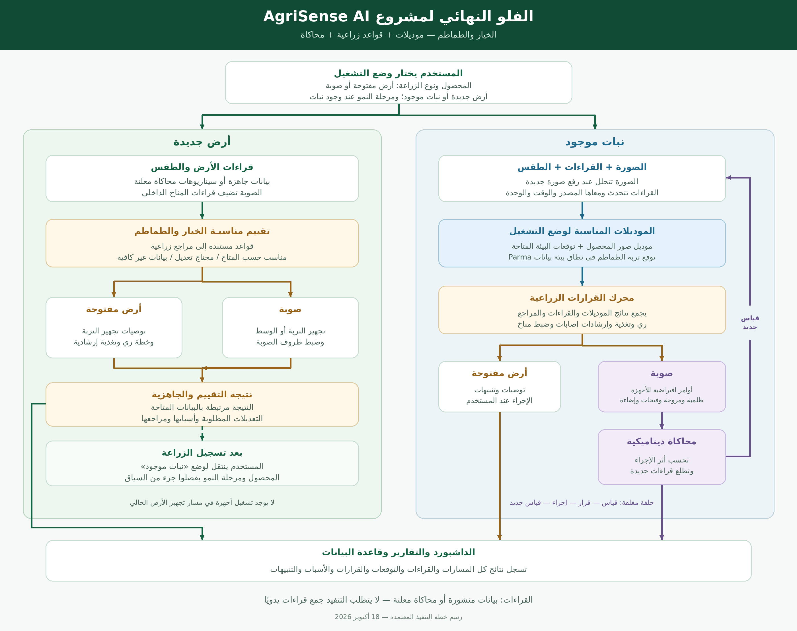

# AgriSense AI — مرجع التنفيذ النهائي المتفق عليه

**الخيار والطماطم | تاريخ تثبيت القرارات: 18 أكتوبر 2026**

الملف ده مرجع مستقل لشغل المشروع اللي اتفقنا عليه: الفلو، الموديلات الخمسة، الداتا الخاصة بكل واحد، القواعد الزراعية ومراجعها، الحساسات، والمحاكاة والربط والاختبار. مش محتاج ترجع لملف قديم عشان تفهمه.

**كلمة «نهائي» هنا معناها خطة التنفيذ المعتمدة في الاتفاق الحالي؛ مش معناها إن الموديلات اتدرّبت أو إن نتائجها اتثبتت بالفعل.**

## 1. القرارات اللي هنمشي عليها

| البند | القرار المعتمد |
|---|---|
| المحاصيل | الخيار والطماطم |
| أوضاع التشغيل | أرض جديدة أو نبات موجود، وكل واحد في أرض مفتوحة أو صوبة |
| جمع الداتا | داتا منشورة وجاهزة؛ مش مطلوب جمع صور أو قراءات من هاردوير بإيدك |
| تحليل الصور | تصنيف الحالة الظاهرة من الفئات المقبولة في الداتا؛ مكان الإصابة وشدتها مش جزء مطلوب حاليًا |
| عدد فئات الصور | مفيش سقف من ثلاث فئات؛ هنستخدم الفئات اللي التسميات والأمثلة والاختبار يدعموها |
| الموديلات | صور الخيار، صور الطماطم، مناخ صوبة الخيار، مناخ صوبة الطماطم، ورطوبة تربة الطماطم |
| القرارات الزراعية | قواعد وحسابات موثقة بالمراجع، بتستخدم القراءات ونتائج الموديلات |
| الأجهزة | طلمبة ومروحة وفتحات تهوية وإضاءة افتراضية؛ والخزان جزء من المحاكاة |
| الأرض المفتوحة | توصيات وتنبيهات وتقارير؛ مفيش تشغيل أجهزة تلقائي في المسار ده |
| التحكم المغلق | داخل محاكاة الصوبة في مسار النبات الموجود؛ القرار لازم يغيّر البيئة ويطلع قياسات جديدة |
| البيانات الناقصة | تظهر كناقصة، أو تتغطى بسيناريو محاكاة معلن؛ مش تتعرض باعتبارها قراءة حقيقية |
| تنفيذ التيم | تجهيز الداتا والموديلات والقواعد والباك والواجهة يقدروا يمشوا بالتوازي بمدخلات ومخرجات متفق عليها |

المستخدم بيحدد المحصول ونوع الزراعة وحالة الأرض. وعند وجود نبات بيحدد مرحلة النمو. وجود صور مراحل نمو في بعض الداتا مش معناه إننا أضفنا موديل تلقائي لمراحل النمو.

## 2. رسمة الفلو النهائي

الصورة مرفقة جنب الملف في الحزمة الكاملة؛ افتح الحزمة بعد فك الضغط عشان الرسم يظهر في عارض Markdown عادي.

### الحالات الأربع

| الوضع | المدخلات الأساسية | المعالجة | الناتج |
|---|---|---|---|
| أرض جديدة + أرض مفتوحة | قراءات تربة وطقس ومعلومات الزراعة | مقارنة باحتياجات المحصولين، وقواعد تجهيز التربة والري والتغذية | تقييم كل محصول، والتعديلات وأسبابها، وتقرير |
| أرض جديدة + صوبة | نفس المدخلات، ومعاها مناخ الصوبة ووسط الزراعة | تقييم الأرض أو الوسط وظروف الصوبة وتجهيزها | جاهزية حسب المتاح أو تعديلات مطلوبة أو بيانات ناقصة |
| نبات موجود + أرض مفتوحة | صورة ومرحلة نمو وقراءات تربة وطقس | موديل صور المحصول، وقواعد الإرشاد؛ وتوقع رطوبة تربة الطماطم في نطاق بياناته | الحالة المتوقعة والتوصيات والتنبيهات والتقرير |
| نبات موجود + صوبة | صورة وقراءات الصوبة والتربة والطقس | موديل الصور، وموديل مناخ الصوبة، ومحرك القرارات، ومحاكاة الأجهزة | توصيات وأوامر افتراضية وقياسات جديدة وسجل نتائج |

بعد تجهيز الأرض وتسجيل الزراعة، المستخدم يغيّر الحالة إلى «نبات موجود». تقرير تقييم الأرض متاح قبل تسجيل الزراعة؛ مش لازم يحصل زرع عشان يظهر.

**مش كل موديل بيتشغّل في كل وضع.** الأرض الجديدة مش محتاجة صورة نبات، وتوقعات السلاسل الزمنية محتاجة سجل قراءات كافي. لو سجل التوقع مش كافي، تفضل القراءات الحالية والقواعد متاحة ويتعرض سبب غياب التوقع.

## 3. الفلو الداخلي للـAI والقرار

1. البرنامج يقرأ سياق الحالة: المحصول، المرحلة، الأرض المفتوحة أو الصوبة، وأرض جديدة أو نبات موجود.
2. يفحص المدخلات: المصدر والوقت والوحدة والقراءات المفقودة أو غير الصالحة.
3. الصورة الجديدة تدخل موديل صور المحصول المناسب. نتيجة صورة قديمة تفضل مرتبطة بوقتها؛ مش تتعرض كتشخيص جديد كل ما الحساسات تتحدث.
4. سجل القراءات يدخل موديل التوقع المناسب للبيئة، لو السجل والمتغيرات المطلوبة متاحين.
5. محرك القرارات يجمع القراءات الحالية والنتائج والمراجع، ويخرج توصية أو إجراء مع السبب.
6. في الأرض المفتوحة، النتيجة إرشاد للمستخدم. في مسار الصوبة والنبات الموجود، الإجراء المناسب يروح للأجهزة الافتراضية.
7. المحاكاة تحدّث حالة البيئة والخزان، وتطلع قراءات جديدة ترجع للدورة، وتتسجل النتائج في الداشبورد والتقرير.

**مش هنركّب صفوف تدريب تربط صورة من بلد بقراءات من بلد تاني ونسميهم عينة حقيقية متزامنة.** ربط نتائج الصور والقراءات بيتم في البرنامج ومحرك القرارات.

## 4. موديل تحليل صور الخيار

**دوره:** تصنيف الحالة الظاهرة في صورة الخيار من الفئات اللي التدريب والاختبار يدعموها.

**المدخل:** صورة خيار. **الناتج:** اسم الحالة المتوقعة ومدى الثقة في النتيجة، أو نتيجة غير حاسمة عند ضعف الثقة أو عدم صلاحية الصورة.

### الداتا الخاصة به

| المصدر | هنستخدم منه إيه؟ | التنزيل |
|---|---|---|
| Cucumber Disease Recognition | أوراق سليم وأنثراكنوز وذبول بكتيري وبياض زغبي ولفحة ساق صمغية. وفيه فئات مستقلة للثمار السليمة وBelly Rot وPythium Fruit Rot | [الصور الأصلية — ZIP، حوالي 564 MB](https://data.mendeley.com/public-files/datasets/y6d3z6f8z9/files/a3560f28-f7eb-47e2-abf5-d4bc0b9a7429/file_downloaded) |
| Cucumber Leaf Disease — Kaggle | 3,754 ملف صورة: سليم وبياض دقيقي وبياض زغبي؛ توثيق طريقة جمعه أقل تفصيلًا من المصادر البحثية | [ZIP، حوالي 506 MB](https://www.kaggle.com/api/v1/datasets/download/kaushigihanml/cucumber-leaf-disease-dataset) |
| Bangladesh Plant Leaf Dataset | جزء الخيار: سليم وبياض زغبي وأنثراكنوز؛ 1,626 صورة حسب وصف المصدر | [المجموعة كاملة — ZIP، حوالي 943 MB](https://data.mendeley.com/public-api/zip/n67gctmjyj/download/3) |
| PlantWild_v2 | جزء الخيار: تبقع زاوي وذبول بكتيري وبياض دقيقي؛ 479 ملف صورة في قائمة الأرشيف اللي اتراجعت | [ZIP، حوالي 1.64 GB](https://huggingface.co/datasets/uqtwei2/PlantWild/resolve/main/plantwild_v2.zip?download=true) |
| OLID I — الخيار | سليم وأعراض نقص N ونقص K ونقص N+K؛ 249 صورة حسب توزيع المصدر | [cucumber.zip، حوالي 731 MB](https://zenodo.org/api/records/8105154/files/cucumber.zip/content) |
| Cucumber Greenhouse — AUC | جزء Healthy / Unhealthy لاختبار النتيجة العامة سليم/غير سليم، مش تقييم اسم مرض محدد. المصدر فيه صور مراحل نمو كمان | [ZIP، حوالي 2.4 GB](https://www.kaggle.com/api/v1/datasets/download/farahseifeld/greenhouse-cucumber-growth-stages) |

### قواعد تجهيز وتنفيذ الموديل

- نحافظ على تمييز الورق والثمار في الفئات والنتائج والتقييم؛ سليم ورق غير سليم ثمرة.
- نجمع الفئات المتوافقة فعلًا، ونشيل الصور المتطابقة والمتشابهة ونوثق مصدرها.
- صور «مصاب» العامة مش هنديها اسم مرض بالتخمين. نقدر نقيّم عليها سليم/غير سليم بتجميع نتائج المصنف المناسبة.
- نبدأ من موديل صور مدرّب مسبقًا ونعمل تدريبًا على بياناتنا، ونختار الإعدادات ببيانات التحقق.
- أعراض نقص N+K فئة مركبة حسب المصدر؛ مش هنعتبر أعراض النقص إثباتًا منفردًا لسبب الحالة أو لجرعة سماد.
- نقيس الأداء لكل فئة، ونحجز اختبارًا منفصلًا قدر الإمكان عن مصادر التدريب.

## 5. موديل تحليل صور الطماطم

**دوره:** تصنيف أمراض وآفات وأعراض نقص العناصر المتاحة في صور الطماطم.

**المدخل:** صورة طماطم. **الناتج:** الحالة المتوقعة ومدى الثقة، أو نتيجة غير حاسمة عند ضعف الثقة أو عدم صلاحية الصورة.

### الداتا الخاصة به

| المصدر | هنستخدم منه إيه؟ | التنزيل |
|---|---|---|
| PlantVillage | جزء الطماطم من الصور الملونة: سليم، تبقع بكتيري، لفحة مبكرة ومتأخرة، عفن ورق، سبتوريا، عنكبوت أحمر، تبقع هدف، فيروس اصفرار وتجعد الورق، وفيروس موزاييك | [ZIP، حوالي 2.18 GB](https://huggingface.co/datasets/mohanty/PlantVillage/resolve/main/data.zip?download=true) |
| Bangladesh Plant Leaf Dataset | جزء الطماطم: 2,449 صورة حسب المصدر؛ سليم وتبقع بكتيري وتجعد ورق فيروسي وذبول متبقع حسب التسميات المنشورة | [ZIP، حوالي 943 MB](https://data.mendeley.com/public-api/zip/n67gctmjyj/download/3) |
| Taiwan Tomato Leaves | سليم وتبقع بكتيري وBlack leaf mold وGray leaf spot ولفحة متأخرة وبياض دقيقي. المصدر بيذكر 622 صورة أصلية ونسخًا معدلة منها | [جزء تايوان فقط — 7z، حوالي 48 MB](https://data.mendeley.com/public-files/datasets/ngdgg79rzb/files/255e82b6-2b3a-41d2-bd07-7bfaf284a533/file_downloaded) |
| Cropped PlantDoc | جزء الطماطم؛ تنوع في الخلفيات وظروف التصوير | [ZIP](https://github.com/pratikkayal/PlantDoc-Dataset/archive/refs/heads/master.zip) |
| PlantWild_v2 | جزء الطماطم: تبقع بكتيري ولفحة مبكرة ومتأخرة وعفن ورق وسبتوريا وموزاييك واصفرار وتجعد الورق؛ 902 ملف صورة في قائمة الأرشيف اللي اتراجعت | [ZIP، حوالي 1.64 GB](https://huggingface.co/datasets/uqtwei2/PlantWild/resolve/main/plantwild_v2.zip?download=true) |
| OLID I — الطماطم | سليم وأعراض نقص N وK وN+K، وصانعات أنفاق وعناكب وفئة إصابة مشتركة | [الجزء الأول — حوالي 1.39 GB](https://zenodo.org/api/records/8105154/files/tomato__part_1.zip/content) · [الجزء الثاني — حوالي 1.50 GB](https://zenodo.org/api/records/8105154/files/tomato__part_2.zip/content) |

**Tomato‑Village مصدر بحثي إضافي اتراجع، لكن ترخيص الداتا ظهر غير واضح.** يحتفظ به منفصلًا؛ دخوله في التدريب مرتبط بتثبيت شروط استخدامه، ومش شرط يعطّل باقي التنفيذ. نسخة التصنيف فيها 4,525 ملف صورة لفئات سليم ولفحة مبكرة ومتأخرة وصانعات أنفاق ونقص N وK وMg وفيروس الذبول المتبقع. [تنزيله من Kaggle](https://www.kaggle.com/api/v1/datasets/download/mamtag/tomato-village) — [مستودع الباحثة](https://github.com/mamta-joshi-gehlot/Tomato-Village).

### قواعد تجهيز وتنفيذ الموديل

- في PlantVillage نستخدم الصور الملونة. الرمادي والصور المعزول منها الورق مشتقة من نفس الأصول، ومش زيادة مستقلة.
- نستخدم جزء تايوان المحدد؛ الجزء الآخر في نفس مصدر Mendeley مأخوذ من PlantVillage.
- فيروسات الموزاييك والذبول المتبقع واصفرار وتجعد الورق تفضل حالات مختلفة. واسم «leaf curl» العام محتاج تحقق قبل مساواته بفيروس محدد.
- Black leaf mold وGray leaf spot ما يتساووش تلقائيًا بـLeaf mold أوSeptoria لمجرد تشابه الاسم.
- باقي خطوات التدريب والاختبار ومنع التكرار زي موديل الخيار.

**المجموعات المشتركة بين المحصولين تتنزّل مرة واحدة، وبعدها نختار مجلدات كل محصول.** وPlantSeg من عائلة PlantWild مش مصدرًا مستقلًا نضيف أعداد صوره فوقها؛ تحديد مكان الإصابة مش مطلوب في التنفيذ الحالي.

### تنزيل OLID والملفات

لو روابط Zenodo المباشرة ما اشتغلتش، فيه [بديل لنفس OLID على Kaggle](https://www.kaggle.com/api/v1/datasets/download/raiaone/olid-i) بحجم حوالي 14.5 GB لكل المحاصيل. ما تنزّلوش مع الأصل وتعتبروهم مجموعتين. ZIP و7z أرشيفات مضغوطة؛ وCSV لو اتفتح كنص يتسجل باسم ينتهي بـ.csv.

## 6. موديل التنبؤ بمناخ صوبة الخيار

**دوره:** توقع حرارة ورطوبة الصوبة، لمساعدة قواعد المناخ والتحكم الافتراضي.

**المدخلات الأساسية:** سجل الحرارة والرطوبة داخل الصوبة، ومعاه الطقس الخارجي والمتغيرات المتاحة المتوافقة. هنختبر فائدة CO₂ ومتغيرات التحكم والإشعاع كمدخلات مساعدة.

**الناتج:** توقع الحرارة والرطوبة بعد أفق زمني معلن. أفق التوقع يتسجل مع التجربة والنتيجة، ويتثبت عند المقارنة بين النماذج.

**الداتا:** WUR Autonomous Greenhouse Challenge، خيار 2018؛ مناخ داخلي وخارجي وإعدادات تحكم وبيانات ري وموارد. [تنزيل ZIP، حوالي 9 MB](https://api.figshare.com/v2/file/download/24075461).

**التنفيذ:** نضبط الوقت والوحدات، ونراجع النواقص والقيم الشاذة، ونكوّن أمثلة من سجل سابق لتوقع المستقبل. التقسيم بالوقت، مع الاحتفاظ بتقييم مستقل واضح. أي مدخل إضافي لازم تتقاس فائدته على الاختبار.

**حدود الاستخدام:** ده توقع مناخ، مش موديل يختار وحده «أفضل» إجراء تحكم. تشغيل ملفات WUR لعرض القراءات مش في حد ذاته اختبار حلقة تحكم مغلقة.

## 7. موديل التنبؤ بمناخ صوبة الطماطم

**دوره:** نفس وظيفة الموديل السابق لكن على بيانات صوبة الطماطم.

**المدخلات الأساسية:** سجل الحرارة والرطوبة داخل الصوبة، والطقس الخارجي المتوافق. وتُختبر المدخلات المساعدة المتاحة، ومنها CO₂ وحالات التهوية والإضاءة.

**الناتج:** توقع حرارة ورطوبة الصوبة لأفق معلن، بنفس قواعد ضبط التجربة.

**الداتا:** WUR Autonomous Greenhouse Challenge، طماطم شيري 2019–2020. [تنزيل 7z، حوالي 8.4 MB](https://api.figshare.com/v2/file/download/24757220). [نسخة Kaggle بديلة لنفس التجربة](https://www.kaggle.com/api/v1/datasets/download/piantic/autonomous-greenhouse-challengeagc-2nd-2019).

**التنفيذ:** تدريب وتقييم منفصلان للطماطم، مع توثيق المتغيرات والوحدات وأفق التوقع. البيانات اللي كانت غير متاحة وقت التوقع ما تدخلش باعتبارها معلومة معروفة.

**حدود الاستخدام:** pH وEC الموجودان للصرف أو المحلول في الداتا مش بديلًا مباشرًا عن pH وEC تربة مقاسين بطريقة أخرى. والقرارات المسجلة للتجربة مش تسميات مؤكدة لـ«أفضل تحكم».

## 8. موديل التنبؤ برطوبة تربة الطماطم

**دوره:** توقع اتجاه رطوبة التربة؛ القرار النهائي للري يفضل في محرك القواعد.

**المدخلات:** الرطوبة السابقة وحرارة التربة والري المسجل والطقس المتاح. وهنختبر فائدة EC كمدخل إضافي. لازم نعرف خط الري وتوقيت العينة ومعنى كل عمود.

**الناتج:** توقع رطوبة التربة لأفق معلن، مع تحديد وقت التوقع.

### الداتا الخاصة به

1. **Parma — مواسم 2023 و2024 و2025:** المصدر الأساسي للتربة والري؛ الأجهزة والأعمدة المتاحة بتختلف بين المواسم. [تنزيل المواسم كلها في ZIP واحد، حوالي 20 MB](https://data.mendeley.com/public-api/zip/h8sfcf9487/download/1).
2. **طقس موقع Parma لنفس السنوات:** مصدر مكمل للمطر والرياح والإشعاع وغيرها، بدقة زمنية مختلفة عن الحساسات. [تنزيل CSV](https://archive-api.open-meteo.com/v1/archive?latitude=44.80787&longitude=10.27467&start_date=2023-01-01&end_date=2025-12-31&hourly=temperature_2m,relative_humidity_2m,precipitation,wind_speed_10m,shortwave_radiation,et0_fao_evapotranspiration&timezone=UTC&format=csv).

**التنفيذ:** نراجع هل عداد المياه تراكمي، ونحسب الفروق مع التعامل مع إعادة الضبط، ونربط القراءات بالوقت والخط الصحيح. التدريب والاختبار بالوقت والموسم، ونقيس الأداء على موسم لاحق لما يكون متاحًا ومتوافقًا.

**نطاق الاستخدام المعتمد:** بيانات Parma لطماطم أرض مفتوحة. التوقع يتعرض في نطاق بيئة متوافقة مع بياناته؛ مش هنعتبره صالحًا للخيار أو لوسط زراعة صوبة مختلف تلقائيًا. ري الصوبة يفضل متاحًا بالقواعد وميزان المياه والمحاكاة.

ما نكررش موسم 2023 من مجموعة Parma الأقدم ونعتبره اختبارًا مستقلًا عن نسخة المواسم الثلاثة. وUdeA الأسبوعية وتجارب تربة الخيار مش داتا التنبؤ اللحظي للموديل ده.

## 9. القرارات الزراعية اللي هتتكتب كقواعد وحسابات

ده جزء أساسي من المشروع: كود بياخد البيانات ونتائج الموديلات، ويطبق شروطًا موثقة ويشرح السبب. وجوده كقواعد مش نقص في الـAI؛ دي الطريقة اللي اتفقنا عليها عشان القرار يبقى مفهومًا وقابلًا للمراجعة.

### أ. مناسبة المحصول وتجهيز الأرض

| الحاجة | المدخلات | القرار اللي هنطلعه | المرجع |
|---|---|---|---|
| مناسبة الخيار والطماطم للأرض | pH وEC والحرارة والطقس، ونوع التربة أو الوسط لو معروف | تقييم كل محصول: مناسب حسب المعلومات المتاحة، محتاج تعديل، أو البيانات مش كافية | [دليل القرعيات للأرض المفتوحة — PDF](https://ask.ifas.ufl.edu/publication/CV123/pdf) · [دليل الطماطم للأرض المفتوحة — PDF](https://ask.ifas.ufl.edu/publication/CV137/pdf) |
| تجهيز التربة | نفس القراءات، مع طريقة قياسها وأي تحليل موثق متاح | مشكلة الحموضة أو الملوحة أو الصرف، والإجراء الإرشادي المناسب وحدود الحكم | [التسميد وإدارة خصوبة التربة للخضار — PDF](https://ask.ifas.ufl.edu/publication/CV296/pdf) |
| جاهزية الصوبة قبل الزراعة | المحصول والوسط وحرارة ورطوبة الهواء والإضاءة، وباقي المتغيرات اللي المرجع بيدعم تفسيرها | جاهزة حسب المتاح، أو تعديلات مطلوبة، أو بيانات ناقصة | [خيار الصوب — PDF](https://ask.ifas.ufl.edu/publication/CV268/pdf) · [طماطم الصوب — PDF](https://ask.ifas.ufl.edu/publication/CV266/pdf) |

لو المحصولين مناسبين، البرنامج يعرض الاتنين وأسباب التقييم؛ مش لازم يخترع محصولًا فائزًا. ولو نوع التربة أو الصرف مش معروفين، ما يكتبش إن الأرض جاهزة بالكامل اعتمادًا على pH وEC بس.

### ب. قرار الري

**المدخلات:** المحصول والمرحلة ووسط الزراعة، والرطوبة الحالية لو متاحة، وتوقع الرطوبة في نطاقه الصحيح، والطقس، والمطر للأرض المفتوحة، ومساحة الزراعة ومواصفات الري لما نحتاج كمية مياه أو زمن تشغيل.

**المخرجات:** احتياج ري أو تأجيل أو معلومات ناقصة، مع السبب. كمية المياه وزمن التشغيل يظهروا بس لما معطيات الحساب متاحة بوحداتها.

- للأرض المفتوحة: نستخدم ميزان مياه التربة وحسابات البخر والنتح المناسبة، مع معامل المحصول وخصائص التربة حسب المرجع والسياق.
- للصوبة: نستخدم مرجع ري الصوب وحالة الوسط وميزان المياه. مطر الجو الخارجي مش ريًّا داخل الصوبة المغطاة.
- لو حساب الري محتاج السعة الحقلية ونقطة الذبول أو حجم الوسط والتصرف ومش موجودين في الداتا، يدخلوا كإعدادات موثقة لسيناريو المحاكاة؛ مش كقراءات مزعومة.
- تنبؤ رطوبة التربة يساعد القرار، لكنه ما يلغيش شروط جودة القراءة أو حدود التشغيل أو حالة الخزان.

**المراجع:** [FAO 56 — الإصدار المحدّث 2025، PDF](https://openknowledge.fao.org/server/api/core/bitstreams/adb9d711-428b-42da-a47f-db6f8b804848/content) · [ري خضروات الصوب — PDF](https://ask.ifas.ufl.edu/publication/CV264/pdf).

### ج. التغذية والتسميد

**المدخلات:** المحصول والمرحلة والوسط، وpH وEC، وأي قيم N وP وK نعرف طريقة قياسها ووحدتها ومعايرتها.

**المخرجات:** ملاحظات على حالة التغذية ومشاكل محتملة وتوصيات تحقق أو إدارة. أعراض النقص في الصورة تعتبر دليلًا مساعدًا، مش تحليلًا معمليًا.

ما نحولش قراءة حساس NPK أو صورة عليها أعراض مباشرة لجرعة سماد بالكيلو. توصيات التسميد مرتبطة بطريقة التحليل وخصائص الوسط والمحصول؛ وقياسات التربة والمحلول والصرف مش قابلة للاستبدال بمجرد إن أسماء الأعمدة متشابهة.

**المراجع:** [تغذية وتسميد خضروات الصوب — PDF](https://ask.ifas.ufl.edu/publication/CV265/pdf) · [خصوبة التربة وتسميد الخضار في الأرض المفتوحة — PDF](https://ask.ifas.ufl.edu/publication/CV296/pdf).

### د. مناخ الصوبة والإضاءة

**المدخلات:** الحرارة والرطوبة الحالية والمتوقعة، والطقس الخارجي، والإضاءة وCO₂ لو متاحين بوحدات ومصدر واضحين، والمحصول والمرحلة.

**المخرجات:** حالة المناخ والتعديلات المطلوبة. داخل محاكاة النبات الموجود، القواعد تختار تشغيل المروحة أو التهوية أو الإضاءة لما الإجراء متاح وله أثر ممثّل في المحاكاة.

ارتفاع الرطوبة ممكن يدعم تنبيه إن الظروف مناسبة لبعض الإصابات، لكنه مش تشخيص مرض ولا تقدير لشدة الإصابة. ولو الوسائل المتاحة مش قادرة تحقق الهدف، يظهر تنبيه بدل تكرار أوامر مالهاش أثر كافي.

**المراجع:** [خيار الصوب — PDF](https://ask.ifas.ufl.edu/publication/CV268/pdf) · [طماطم الصوب — PDF](https://ask.ifas.ufl.edu/publication/CV266/pdf).

### هـ. إرشادات الأمراض والآفات

**المدخلات:** فئة الصورة ومدى الاعتماد على النتيجة ووقت الصورة، والمحصول والجزء المصوَّر، والسياق البيئي الموثوق المتاح.

**المخرجات:** شرح الحالة المتوقعة وخطوات متابعة وإدارة زراعية مناسبة، أو طلب تحقق لو النتيجة غير حاسمة. تفاصيل مكان الإصابة أو شدتها مش هتتولد بالتخمين.

**المراجع:** [إرشادات القرعيات — PDF](https://ipm.ucanr.edu/legacy_assets/pdf/pmg/pmgcucurbits.pdf) · [إرشادات الطماطم — PDF](https://ipm.ucanr.edu/legacy_assets/pdf/pmg/pmgtomato.pdf) · [النسخة الحالية على موقع UC IPM للقرعيات](https://ipm.ucanr.edu/agriculture/cucurbits/) · [النسخة الحالية للطماطم](https://ipm.ucanr.edu/agriculture/tomato/).

ملفات PDF هنا مرجع زراعي، وبعضها أقدم من صفحات الموقع. مش هننقل جرعات مبيدات أمريكية باعتبارها توصية محلية، ومفيش رش مبيدات أو حقن سماد تلقائي ضمن أجهزة المشروع.

### إزاي نحول المرجع لقاعدة قابلة للتنفيذ؟

لكل قاعدة هنسجل: اسمها، والمحصول والمرحلة، وأرض مفتوحة أو صوبة، ونوع الوسط، والمتغير ووحدته، والشرط، والقرار وسببه، ورابط المرجع والصفحة أو القسم، والتصرف عند نقص البيانات أو تعارضها.

القيم الرقمية تتاخد من القسم المناسب في المرجع ويتسجل سياقها؛ مش هنثبت رقم رطوبة أو pH أو CO₂ واحد لكل المحاصيل والمراحل. تجهيز الإعدادات من المراجع جزء من كتابة البرنامج، ومش محتاج تركيب هاردوير أو تجميع قراءات بإيدك.

فيه فرق واضح في التوثيق بين **قاعدة زراعية من مرجع**، و**قاعدة تشغيل هندسية** زي إيقاف الطلمبة عند انخفاض الخزان أو قِدم القراءة. حدود التشغيل الهندسية تتحدد في إعدادات المحاكاة، وما تتنسبش لمرجع زراعي.

## 10. الداتا اللي هتخدم القواعد واختبارات الربط

الداتا اللي تحت هنستخدمها كحالات إدخال وتجارب مقارنة وفحص وحدات وتكامل. وجودها بصيغة CSV مش معناه إنها لازم تدخل تدريب موديل؛ اللي بيحدد ده هو نوع القياسات وتكرارها ووجود هدف مناسب للتعلم.

| المصدر | هيفيدنا في إيه؟ | مش هنفترض منه إيه؟ | التنزيل |
|---|---|---|---|
| UdeA Tomato Dataset | بيانات صوبة طماطم، فيها قياسات تربة وNPK وpH وEC؛ مفيدة لاختبار مسار قواعد التربة والتغذية والتعامل مع النواقص | القياسات أسبوعية، ومش تسميات لقرار تسميد مثالي أو بيانات توقع لحظي | [CSV مباشر](https://raw.githubusercontent.com/parregoces/UdeA_TomatoDataset/main/DB_Mobile_Manual_Tomato.csv) · [سجل المصدر](https://zenodo.org/records/16745911) |
| تجربة تربة الخيار: مياه وتعديلات تربة | حالات تربة ومعاملات مختلفة، منها pH وEC وN ونتائج محصول؛ تفيد فحص تفسير المتغيرات في سياق التجربة | مش سلسلة قراءات حساسات لحظية، ومش قاعدة عامة لتحديد جرعة لكل أرض | [ZIP](https://data.mendeley.com/public-api/zip/hxpp54pzgj/download/1) · [وصف المصدر](https://data.mendeley.com/datasets/hxpp54pzgj/1) |
| تجربة الخيار متعددة المواسم والتلقيح الميكروبي | خصائص تربة وعناصر متاحة ومعاملات ونتائج نمو أو محصول، للمقارنة والاختبارات الزراعية | مش داتا تدريب لموديل تحكم أو رطوبة مستقبلية | [ZIP](https://data.mendeley.com/public-api/zip/csysvfb2r9/download/1) · [وصف المصدر](https://data.mendeley.com/datasets/csysvfb2r9/1) |
| WUR للخيار والطماطم | اختبار قراءة المناخ والري والمحلول والصرف وقواعد الصوبة | مش قراءات 7-in-1 تربة كاملة، ومش حالات خزان أو أوامر أجهزة مثالية | روابط التنزيل في جزئي موديلات مناخ الصوبة |
| Parma | حالات تربة وري حقيقية لاختبار الربط والحسابات، بجانب دورها في موديل التوقع | عداد المياه مش حساس مستوى خزان، وبيئتها مش صوبة خيار | رابط التنزيل في جزء موديل رطوبة التربة |

في ملف UdeA اللي اتراجع فيه 2,665 صف بيانات، وقراءات الحساس السباعية مكتملة في 693 صف فقط. الباقي مش هنعوضه تلقائيًا بقيم نعرضها كأنها مقاسة. وبنراجع الصفر: هل قيمة صحيحة ولا علامة فشل أو نقص حسب العمود وسياق القياس؟

لو هنقول إن القواعد «صحيحة»، اختبارها بيكون بمطابقة المرجع وحالات متوقعة موثقة. نجاحها في قراءة CSV وحده مش إثبات إن قراراتها الزراعية صحيحة، ونتيجة محصول معاملة بحثية مش معناها تلقائيًا إنها أفضل اختيار لكل بيئة.

### بيانات الطقس

- بيانات WUR الأصلية الخارجية هي الاختيار الأول لمزامنة توقع مناخ صوبتها.
- بيانات Parma تتربط بطقس نفس المكان والتاريخ، بعد ضبط المنطقة الزمنية والتردد.
- لتجربة سيناريو محلي، ده [طقس القاهرة 2023–2025 بصيغة CSV](https://archive-api.open-meteo.com/v1/archive?latitude=30.0444&longitude=31.2357&start_date=2023-01-01&end_date=2025-12-31&hourly=temperature_2m,relative_humidity_2m,precipitation,wind_speed_10m,shortwave_radiation,et0_fao_evapotranspiration&timezone=UTC&format=csv). الإحداثيات مثال قابل للتغيير، مش موقع مزرعتك المفترض.
- وده [NASA POWER للقاهرة لنفس السنوات — CSV يومي](https://power.larc.nasa.gov/api/temporal/daily/point?parameters=T2M,RH2M,PRECTOTCORR,WS2M,ALLSKY_SFC_SW_DWN&community=AG&longitude=31.2357&latitude=30.0444&start=20230101&end=20251231&format=CSV)، للمقارنة والسياق اليومي؛ مش بديلًا مطابقًا لقراءات كل دقائق.
- الطقس وقت تشغيل البرنامج ييجي من API مرتبط بإحداثيات السيناريو. [توثيق التوقعات](https://open-meteo.com/en/docs) · [توثيق التاريخي](https://open-meteo.com/en/docs/historical-weather-api).

بيانات الطقس التاريخية المعاد تحليلها مش هي نفسها توقعات كانت متاحة وقت اتخاذ القرار. في تقييم تنبؤ واقعي، ما نديش الموديل طقس المستقبل الحقيقي ونقدّم النتيجة باعتبارها توقعًا بمدخلات كانت معروفة وقتها.

## 11. كل حساس هيدخل في إيه بالضبط؟

عندنا **5 أجهزة قياس بتطلع 12 قراءة**، ومعاهم الكاميرا والطقس الخارجي. القراءات في النسخة دي تيجي من الداتا الجاهزة لما تكون متاحة ومتوافقة، ومن المحاكاة لباقي السيناريوهات؛ مش مطلوب تجميعها بإيدك.

| الجهاز أو القراءة | هتدخل أي موديل؟ | هتفيد الموديل في إيه؟ | هتدخل أي قاعدة وليه؟ |
|---|---|---|---|
| 7-in-1: رطوبة التربة | موديل رطوبة تربة الطماطم | السجل السابق هو مدخل أساسي، والرطوبة المستقبلية هي هدف التوقع | قرار الري ومتابعة جفاف الوسط؛ مراجع FAO وري الصوب |
| 7-in-1: حرارة التربة | موديل رطوبة تربة الطماطم | سياق يفسر تغير الرطوبة؛ فائدته تتقاس بالاختبار | مناسبة ظروف التربة والجاهزية حسب المحصول؛ أدلة المحصول وتجهيز الأرض |
| 7-in-1: pH التربة | مفيش موديل معتمد محتاجه حاليًا | — | الحموضة ومناسبة الوسط وإتاحة العناصر؛ مرجع خصوبة التربة |
| 7-in-1: EC التربة | مدخل إضافي مرشح لموديل رطوبة الطماطم | يتثبت بس لو حسن الاختبار، وبنفس تفسير القياس | الملوحة والتغذية وأثرها على امتصاص المياه؛ مراجع التربة والري والتغذية |
| 7-in-1: N | مفيش مدخل N حساس في موديلاتنا الحالية | — | حالة التغذية بعد توثيق طريقة القياس؛ مش حساب جرعة تلقائي |
| 7-in-1: P | مفيش مدخل P حساس في موديلاتنا الحالية | — | تفسير التغذية مع pH والمحصول وطريقة التحليل |
| 7-in-1: K | مفيش مدخل K حساس في موديلاتنا الحالية | — | تفسير التغذية مع باقي المعلومات؛ مرجع التسميد المناسب للوسط |
| SHT31: حرارة الهواء داخل الصوبة | موديل مناخ صوبة المحصول | مدخل تاريخي وواحد من هدفي التوقع | الجاهزية والتهوية والمروحة؛ أدلة الصوب |
| SHT31: الرطوبة النسبية داخل الصوبة | موديل مناخ صوبة المحصول | مدخل تاريخي والهدف الثاني للتوقع | الرطوبة والتهوية والتنبيه لظروف مساعدة على الإصابة؛ مش تشخيصًا للمرض |
| BH1750: الإضاءة بالـlux | مش مدخلًا مباشرًا معتمدًا للموديلات الحالية | متغيرات إشعاع WUR مش lux تلقائيًا | متابعة الإضاءة ومحاكاتها، بحدود متوافقة مع وحدة القياس |
| MH-Z19B: CO₂ | مدخل مساعد مرشح لموديلَي مناخ الصوبة | نقيس هل إضافته بتحسن توقع الحرارة والرطوبة | متابعة سياق الصوبة والتنبيه حسب المرجع؛ مفيش حقن CO₂ آلي ضمن الأجهزة |
| مستوى مياه الخزان | مفيش موديل | — | السماح بالري أو منعه والتنبيه حسب إعدادات المحاكاة؛ دي قاعدة تشغيل هندسية |
| الكاميرا | موديل صور الخيار أو الطماطم | تصنيف الحالة الظاهرة | نتيجة الصورة تدخل إرشادات الإصابة أو أعراض النقص، مع وقتها ودرجة الاعتماد عليها |
| الطقس الخارجي | موديلات المناخ، وموديل تربة الطماطم حسب نطاقه | يفسر تأثير البيئة الخارجية بالمتغيرات المتاحة | المطر والبخر والنتح في الأرض المفتوحة، وسياق تهوية الصوبة |

**أربع نقاط لازم تفضل واضحة في الربط:**

1. الحساسات مش مدخلات لموديلات الصور الحالية؛ الدمج بيحصل بعد نواتج الموديلات داخل محرك القرارات.
2. حرارة ورطوبة الجو الخارجي في Parma مش بديلًا عن حرارة ورطوبة داخل صوبة مقاسة بـSHT31.
3. الـlux مقياس إضاءة مختلف عن PAR والإشعاع بوحدة W/m²؛ مفيش تحويل عام ثابت نستخدمه بين كل المصادر. لو المرجع محتاج PAR ومش متاح، نعرض النقص أو نستخدم قيمة محاكاة معلنة بوحدتها. [توثيق BH1750](https://learn.adafruit.com/adafruit-bh1750-ambient-light-sensor).
4. الداتا الجاهزة مش لازم تكون اتجمعت بنفس موديل الحساس المكتوب في تصميمنا. إحنا بنطابق نوع القياس ووحدته وطريقته، وبنسجل الجهاز الأصلي لو معروف؛ ما ندّعيش إن ملف WUR اتجمع بأجهزتنا.

الـ7-in-1 في التصميم واجهة لقراءات التربة السبع؛ وجود القيم في خرج الجهاز وحده مش إثبات لدقتها أو صلاحيتها لكل توصية. مفيش تدريب أو نشر واقعي متحقق على أجهزة المشروع في الاتفاق الحالي؛ الاختبار النهائي هنا بالداتا والمحاكاة.

## 12. المحاكاة اللي هننفذها

المطلوب بيئة افتراضية لها حالة بتتغير مع الوقت والأوامر. تشغيل صفوف CSV كما هي مفيد لاختبار إدخال البيانات، لكن ما يختبرش أثر تشغيل طلمبة أو مروحة.

### أجزاء المحاكاة

| الجزء | اللي هيمثله | البيانات أو المرجع اللي يساعده |
|---|---|---|
| مناخ الصوبة | حرارة ورطوبة الهواء، وتأثير الجو الخارجي والتهوية والمروحة والإضاءة حسب النموذج المتاح | WUR للمحصول المناسب، وأدلة الصوب، وGreenLight كأساس ممكن تكييفه |
| مياه التربة أو وسط الزراعة | دخول مياه الري وخروجها بالاستهلاك والصرف، وتغير حالة الرطوبة | FAO ومرجع ري الصوب، وبيانات Parma للمقارنة داخل نطاقها |
| الخزان والطلمبة | سعة ومستوى وتناقص مع الضخ، ومنع التشغيل لما المياه مش كفاية | إعدادات سيناريو معلنة ومعادلة كمية المياه والتصرف والزمن |
| الأجهزة الافتراضية | أوامر تشغيل/إيقاف أو نسبة فتح حسب الجهاز، وحدود القدرة وزمن الاستجابة | إعدادات هندسية موثقة للمحاكاة |
| الأعطال والنواقص | قراءة قديمة أو مفقودة، جهاز لم يستجب، خزان منخفض أو مصدر طقس غير متاح | سيناريوهات اختبار بنجهزها برمجيًا |

**مصدر محاكاة مساعد:** [تنزيل GreenLight — ZIP](https://github.com/davkat1/GreenLight/archive/refs/heads/main.zip) · [توثيق الاستخدام](https://greenlight.readthedocs.io/en/latest/user/using_greenlight.html).

GreenLight نموذج وبيئة لبناء محاكاة الصوبة، مش ملف داتا ولا حل جاهز لكل المحاصيل والأجهزة اللي عندنا. لازم نضبط معطيات المحصول والصوبة، ونضيف أو نكيف أجزاء الخزان والري والأجهزة اللي مش ممثلة بالشكل المطلوب. ولو علاقة تأثير مروحة معينة مش متحققة تجريبيًا، نسميها فرضية سيناريو ونوضحها في النتائج.

### دورة التحكم المعتمدة

1. المحاكاة تطلع الحالة الحالية وقراءات الحساسات الافتراضية.
2. البرنامج يفحص جودة القراءات، ويحدّث التوقع المناسب لو شروطه متاحة.
3. محرك القرارات يحدد الإجراء وأسبابه، ووحدة التحكم تراجع حالة الخزان والأجهزة والبيانات.
4. الإجراء يتطبق داخل المحاكاة لفترة زمنية معلنة.
5. المحاكاة تحسب الحالة الجديدة، وبعدين القياسات الجديدة ترجع للبرنامج.

نستخدم فرقًا بين حد التشغيل وحد الإيقاف، وحدًا أدنى مناسبًا لمدة التشغيل أو التوقف؛ عشان الجهاز ما يفضلش يفصل ويشتغل بسرعة حول نفس الحد. القيم تتسجل كإعدادات، وتُختبر مع كل سيناريو.

لما البيانات تبقى غير صالحة، أو الجهاز أو الخزان يمنع الإجراء، النظام يوقف الإجراء المعتمد عليه أو يستخدم التصرف الاحتياطي المحدد، ويسجل السبب. ما يفضلش ينفذ أمرًا قديمًا بدون حدود زمنية.

### السيناريوهات اللي لازم نعرضها في المشروع

| السيناريو | المطلوب نلاحظه |
|---|---|
| صوبة حرارتها بتزيد | هل التهوية أو المروحة بتغيّر الحرارة فعلًا حسب نموذجها؟ وهل يظهر تنبيه لو قدرتها مش كفاية؟ |
| رطوبة هواء عالية | قرار موثق، وأثر الإجراء على الحالة الجديدة؛ من غير اختراع مرض |
| وسط جاف والخزان فيه مياه | تشغيل الري ضمن حدود السيناريو، وتغير الرطوبة ومستوى الخزان |
| خزان منخفض | منع الضخ المعتمد على المياه، مع تنبيه وتسجيل السبب |
| قراءة مفقودة أو قديمة | اكتشافها، وعدم تقديمها كأنها قراءة حالية موثوقة |
| جهاز مش بيستجيب | فرق واضح بين الأمر المطلوب والحالة الفعلية، وتنبيه |
| إضاءة خارج الهدف | قرار يتفق مع الوحدة وقدرة الإضاءة الافتراضية والجدول المستخدم |
| صورة نتيجتها غير حاسمة | يفضل التحكم البيئي المستقل شغالًا بشروطه، من غير توصية مرض مؤكدة |
| أرض مفتوحة | توصية وتقرير فقط، من غير إرسال أوامر أجهزة |

التقييم يسجل وقت البقاء خارج نطاق المناخ، وكمية المياه المحسوبة، وعدد الأوامر والتبديل، وحالات المنع والتنبيهات. نقارن على **نفس السيناريو** بجدول ثابت أو قواعد بدون توقع، وبالقواعد مع التوقع، لما التوقع صالح لبيئة السيناريو. التحسن داخل المحاكاة يتعرض كتحسن محاكاة؛ ما نترجموش لتوفير مياه أو زيادة محصول مثبتة في مزرعة حقيقية.

## 13. ربط الـAI والقواعد بالسوفت وير

الأجزاء اللي هننفذها في البرنامج:

| الجزء | مسؤوليته |
|---|---|
| إدخال البيانات | قراءة الملفات وAPI الطقس والمحاكاة، وتوحيد أسماء المتغيرات والوحدات والوقت |
| فحص الجودة | كشف النقص والقراءات القديمة والأخطاء، والاحتفاظ بالقيمة الأصلية وسبب استبعادها |
| خدمات الموديلات الخمسة | استقبال الصورة أو السجل المناسب وإرجاع النتيجة ووقت إصدارها ونطاق استخدامها |
| محرك القواعد | تطبيق القواعد الزراعية على السياق والقراءات والنتائج، وإرجاع القرار والسبب والمرجع |
| وحدة التحكم | تحويل القرار المسموح لأمر جهاز افتراضي، مع حدود التشغيل ومنع التعارض |
| المحاكاة | حساب أثر الأوامر وتوليد الحالة والقياسات الجديدة |
| قاعدة البيانات | حفظ السياق والصور ونتائجها والقراءات والتوقعات والقرارات والأوامر والأحداث |
| الداشبورد والتقارير | عرض حالة المشروع ونتائجه ومصادرها وما ينقصها، ومقارنة الأمر باستجابة الجهاز |

### المعلومات اللي لازم تمشي مع كل نتيجة

- **القراءة:** اسم المتغير، والقيمة والوحدة والوقت، والموقع أو المقصورة، وهل هي مسجلة من مصدر منشور أو مولّدة بمحاكاة، وحالة جودتها.
- **نتيجة الصورة:** المحصول والجزء المصوَّر والفئة ووقت الصورة وإصدار الموديل، ومدى الاعتماد على النتيجة.
- **التوقع:** المتغير والوقت المستهدف وأفق التوقع وإصدار الموديل، والمدخلات المتاحة، وأي سبب يمنع استخدامه.
- **القرار:** الإجراء والسبب والقاعدة ومرجعها والقيم اللي أثرت فيه، وهل هو توصية للمستخدم ولا أمر محاكاة.
- **أمر الجهاز:** المطلوب ووقت الإرسال، والحالة المنفذة لو وصلت، وسبب المنع أو الفشل.

الواجهة تفرق بوضوح بين القياس التاريخي والمحاكاة والتوقع. ما تكتبش «الحساس قرأ» على قيمة مولدة، ولا تعرض نتيجة صورة قديمة كأنها تشخيص متجدد.

نثبت شكل المدخلات والمخرجات ده بين أعضاء التيم من البداية. بعدها تجهيز الصور وتدريب الموديلات وتجهيز القواعد والمحاكاة والباك والواجهة يقدروا يمشوا بالتوازي، ويترابطوا بنفس الصيغ؛ مفيش احتياج تنتظروا جمع داتا من أجهزة عشان يبدأ الشغل.

**الربط بالهاردوير في التصميم:** وحدة إدخال القراءات ووحدة أوامر الأجهزة يبقوا قابلين لتوصيل مصدر فعلي بدل المحاكاة لاحقًا. ده تصميم واجهات؛ التنفيذ والتقييم الحاليين مش معتمدين على شراء الأجهزة أو جمع قراءاتها، ومش هنكتب إن الربط الفعلي اتجرب طالما متجربش.

## 14. اختبارات القبول اللي هنحكم بيها على الشغل

### موديلات الصور

- نتأكد إن الفئات وعدد الصور ومصدرها واضحين بعد التنظيف، ونحتفظ بسجل الفئات المقبولة والمستبعدة وسبب الاستبعاد.
- نقسم الصور الأصلية قبل أي زيادة أو تعديل. نفس الورقة أو النبات أو الأصل ومشتقاته يفضلوا في نفس الجزء، لما معلومات التجميع متاحة.
- نعزل المتطابق والمتشابه بين المصادر قبل التقسيم. كثرة أسماء المصادر مش دليل على تنوع مستقل.
- نسجل الدقة وPrecision وRecall وF1 لكل فئة، وMacro-F1 ومصفوفة الالتباس، مع نتائج مستقلة لكل مصدر اختبار مناسب.
- نستخدم الاختبار الخارجي على الفئات المشتركة فعلًا. مجموعة سليم/مصاب تقيس التمييز العام، مش أسماء أمراض غير موجودة في تسمياتها.
- نختار حدود قبول النتيجة ببيانات التحقق، ونقيس أخطاء الحالات غير الحاسمة. قيمة خرج المصنف وحدها مش احتمالًا طبيًا أو زراعيًا معايرًا، ولا ضمانًا لاكتشاف كل مرض جديد.

### موديلات التوقع الثلاثة

- التقسيم بالوقت والموسم أو المقصورة حسب المصدر، من غير خلط عشوائي للماضي والمستقبل. المقصورات المتزامنة ممكن تشترك في الطقس؛ ده يتوثق عند تفسير استقلال الاختبار.
- المعالجة والإعدادات اللي بتتعلم من البيانات تتضبط على التدريب بس. ملء النواقص ما يستخدمش بيانات مستقبلية غير متاحة وقت التوقع.
- نسجل MAE وRMSE **بوحدة المتغير** ولكل أفق توقع، ونقارن على نفس العينات بخط أساس بسيط زي آخر قراءة معروفة.
- نراجع الأعمدة اللي كانت متاحة فعلًا وقت التوقع، خصوصًا الطقس وأوامر الري والتحكم؛ الأمر المستقبلي ما يدخلش إلا لو خطة معروفة ومعلنة وقتها.
- نوضح نطاق الاختبار؛ النجاح على صوبة أو موسم ما يثبتش تلقائيًا النجاح على مزرعة أو محصول مختلف.

### القواعد والمحاكاة والربط

- لكل قاعدة: حالة تحقق الشرط، وحالة لا تحققه، وحالة عند الحد، وحالة نقص بيانات، مع مرجع النتيجة المتوقعة.
- نختبر اختلاف الوحدات والسياق: تربة مقابل محلول، داخل مقابل خارج الصوبة، lux مقابل PAR، وعدّاد مياه مقابل مستوى خزان.
- نختبر الحالات الأربع في الفلو، وظهور تقرير الأرض قبل الزراعة، وتشغيل الموديلات المناسبة فقط.
- المحاكاة لازم تستجيب للأوامر، وتسجل توازن المياه وحدود الخزان وحالة الجهاز. ممنوع اعتبار CSV ثابت دليلًا على تحكم ناجح.
- أي تجربة تتسجل بمعرف وسياق وإعدادات ونسخة بيانات وموديل وقواعد، عشان نقدر نعيدها ونفهم سبب النتيجة.

مش هنكتب نسب دقة أو توفير مياه مستهدفة باعتبارها نتائج اتثبتت. بنسجل النتائج الفعلية، وأي جزء ضعيف يتعرض بحدوده بدل تجميله بزيادة داتا مكررة.

## 15. تنظيم الداتا والمراجع وشروط استخدامها

لكل مجموعة نحتفظ بالنسخة الأصلية ووصف المصدر والترخيص، وبنسخة معالجة منفصلة وسجل التعديلات. البيانات المتكررة بين المحصولين أو بين نسخة Kaggle والأصل تتنزّل وتتحسب مرة واحدة.

| المصادر | حالة الترخيص المنشورة اللي لازم نسجلها |
|---|---|
| Cucumber Disease Recognition، Bangladesh، Taiwan، OLID، PlantDoc، Parma وتجربتا تربة الخيار | CC BY 4.0 حسب سجلات المصادر؛ نحتفظ بنسبة العمل للمصدر |
| PlantVillage | CC BY-SA 3.0 حسب بيانات النسخة؛ نوثق المصدر والترخيص وأي مشتقات |
| PlantWild_v2 | CC BY-NC-ND 4.0؛ نسجل قيود الاستخدام غير التجاري والمشاركة، وما نفترضش إن كل صور الإنترنت مفتوحة بلا شروط |
| WUR للخيار والطماطم | CC0 حسب سجلي المجموعتين |
| Cucumber Leaf Disease على Kaggle | Apache 2.0 ظاهر في صفحة المجموعة؛ نحتفظ بوصفها ومصدر صورها المتاح |
| AUC Cucumber على Kaggle | CC0 ظاهر في صفحة المجموعة |
| UdeA | سجل Zenodo يذكر CC BY 4.0، وفي GitHub بيان مختلف؛ نعتمد توثيق المصدر ونحافظ على نسبته ونسجل الاختلاف |
| Tomato-Village | غير محسوم في النسخة اللي اتراجعت؛ يفضل خارج التدريب المعتمد لحد تثبيت الشروط |
| Open-Meteo | ننسب البيانات حسب CC BY 4.0، ونراعي [شروط خدمة الـAPI](https://open-meteo.com/en/terms) عند الاستخدام |
| GreenLight | كود بترخيص BSD-3-Clause-Clear؛ نحفظ ملف الترخيص مع النسخة المستخدمة |

ده سجل عمل للتيم، والنسخة اللي بتنزل هي اللي نراجع بيانها ونحفظه؛ مش بنستنتج ترخيصًا جديدًا من وجود رابط مباشر.

**للمراجعة من المصدر الأصلي:** [خيار Mendeley](https://data.mendeley.com/datasets/y6d3z6f8z9/1) · [Bangladesh](https://data.mendeley.com/datasets/n67gctmjyj/3) · [Taiwan](https://data.mendeley.com/datasets/ngdgg79rzb/1) · [PlantWild](https://tqwei05.github.io/PlantWild/) · [OLID](https://zenodo.org/records/8105154) · [WUR خيار](https://research.wur.nl/en/datasets/autonomous-greenhouse-challenge-first-edition-2018/) · [WUR طماطم](https://research.wur.nl/en/datasets/autonomous-greenhouse-challenge-second-edition-2019/) · [Parma](https://data.mendeley.com/datasets/h8sfcf9487/1).

### ملاحظات التنزيل

- الروابط فوق مخصصة للملف أو الأرشيف قدر الإمكان. Kaggle ممكن يطلب تسجيل دخول أو قبول الشروط حسب المجموعة والجلسة؛ ده سلوك المصدر، مش نقص في الملف.
- روابط Zenodo المباشرة لـOLID اتعرضت لمنع وصول من بيئة التحقق؛ عشان كده البديل موجود في جزء التنزيل. ما بنضمنش إن كل مصدر هيفضل متاحًا بنفس الرابط للأبد.
- الأحجام والأعداد المذكورة تخص النسخ المنشورة أو قوائم الملفات اللي اتراجعت، وممكن تختلف عن عدد الصور الصالحة النهائي بعد التنظيف. فتح رابط أو مراجعة قائمة أرشيف مش معناه إن كل صورة فيه اتفحصت بصريًا.
- مفيش مجموعة واحدة بتغطي كل الحساسات وكل الصور في نفس اللحظة والمزرعة. تغطية المشروع جاية من تدريب كل موديل على داتاه، وقواعد موثقة، ومحاكاة معلنة بتختبر الربط والتحكم.

## 16. اللي هيتسلّم في المشروع

| المخرج | محتواه |
|---|---|
| موديل صور الخيار | الفئات المعتمدة وملف الموديل ونتائج اختبار كل فئة وحدود الاستخدام |
| موديل صور الطماطم | نفس المخرجات الخاصة بالطماطم |
| موديل مناخ صوبة الخيار | توقع الحرارة والرطوبة، وأفق التوقع، ونتائج المقارنة بخط الأساس |
| موديل مناخ صوبة الطماطم | نفس المخرجات الخاصة بالطماطم |
| موديل رطوبة تربة الطماطم | توقع الرطوبة ونتائج الاختبار ونطاق البيئة اللي ينفع يستخدم فيها |
| محرك القواعد | قواعد مناسبة المحصول والتجهيز والري والتغذية والمناخ وإرشادات الإصابات، وكل قاعدة معاها مرجعها وسبب القرار |
| محاكاة الصوبة والأجهزة | حالة ديناميكية وخزان ووسط زراعة وأجهزة افتراضية وسيناريوهات التشغيل والأعطال |
| التطبيق | الحالات الأربع، وربط الصور والقراءات والنتائج والقرارات، وداشبورد وتنبيهات وتقارير وقاعدة بيانات |
| توثيق التجارب | مصادر وتراخيص وتقسيمات وتنظيف ونتائج وحدود الاستخدام، مع تمييز المسجل عن المحاكاة |

**ده نطاق التنفيذ المعتمد كاملًا:** خمسة موديلات، ومحرك قواعد زراعية، ومحاكاة تحكم، وتطبيق يربطهم. تنفيذ النطاق ده مش محتاج منك جمع قراءات هاردوير أو تعليم صور بإيدك.
